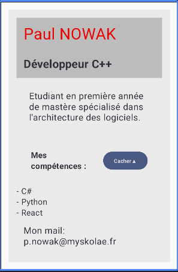

# Profil Développeur

## Description du projet

Dans ce devoir, on affiche la fiche profil d'un étudiant développeur afin de connaître des informations le concernant. En effet, il est composé d'un en-tête avec le nom et le titre du développeur en question, une description courte de celui-ci, un bouton permettant d'afficher ou non la liste des compétences informatiques qu'il possède, et finalement son mail de contact. L'écran possède 2 previews: une preview où les compétences sont montrées, et une autre où les compétences sont masquées.



## Composition du projet

### Thème

Le thème du projet s'intitule **ProfilDeveloppeurTheme**: c'est lui qui gère l'apparence générale de l'applicatione et qui contient le **Scaffold** (l'échafaudage) qui s'occupera de la structure de base de l'écran

### Les différents composables

L'arbre de composition suivant montre la hiérarchie des différents composables du projet:

```
DeveloperScreen
└── DeveloperFile
    ├── Surface
    └── DeveloperFileContent
        └── Column
            ├── DeveloperHeading
            │   └── Surface
            │      └── Column
            │          ├── DeveloperName
            │          │   └── Text
            │          └── DeveloperTitle
            │              └── Text
            ├── DeveloperDescription
            │   └── Text
            ├── DeveloperSkillsSection
            │   ├── Row
            │   │   ├── Text
            │   │   └── ShowSkillsButton
            │   │       └── Button
            │   │           └── Text
            │   └── DeveloperSkillsList
            │       └── Column
            │           ├── DeveloperUniqueSkill
            │           │   └── Text
            │           ├── DeveloperUniqueSkill
            │           │   └── Text
            │           └── DeveloperUniqueSkill
            │               └── Text
            │   
            └── DeveloperMail
                └── Text
```

Concernant les différents composables:

#### DeveloperScreen

Il s'agit simplement du premier écran de l'application: il a un simple modifier comme paramètre, et son enfant est un composant **DeveloperFile** (avec un padding externe de 1- dp) qu'il faudra paramétrer quand appelé.

#### DeveloperFile

Il représente la fiche de profil et il prends beaucoup de paramètres: 
- 4 String (Name, Title, text, mail)
- un Array de String appelé skillsList, représentant la liste des compétences de l'utilisateur
- un booléen **isShown** qui détermine si les compétences sont montrées ou non
- 2 évènements **onFileClick** et **onSkillsClick**
- un simple modifier

Il est séparé en 2 parties: une Surface pour gérer le conteneur cliquable (via **onFileClick**) sur la carte , et un composant DeveloperFileContent pour l'organisation interne.


#### DeveloperFileContent

Comme dit précedemment, il gère l'organisation interne de son composant parent **DeveloperFile** et prend tous ses paramètres à l'exception de **onFileClick**.

Il contient un conteneur de type **Column** qui contient lui-même 4 composants: **DeveloperHeading**, **DeveloperDescription**, **DeveloperSkillsSection** et **DeveloperMail**.

#### DeveloperHeading

Ce composant représente l'

#### DeveloperScreen

Il s'agit simplement 

#### DeveloperScreen

Il s'agit simplement 
